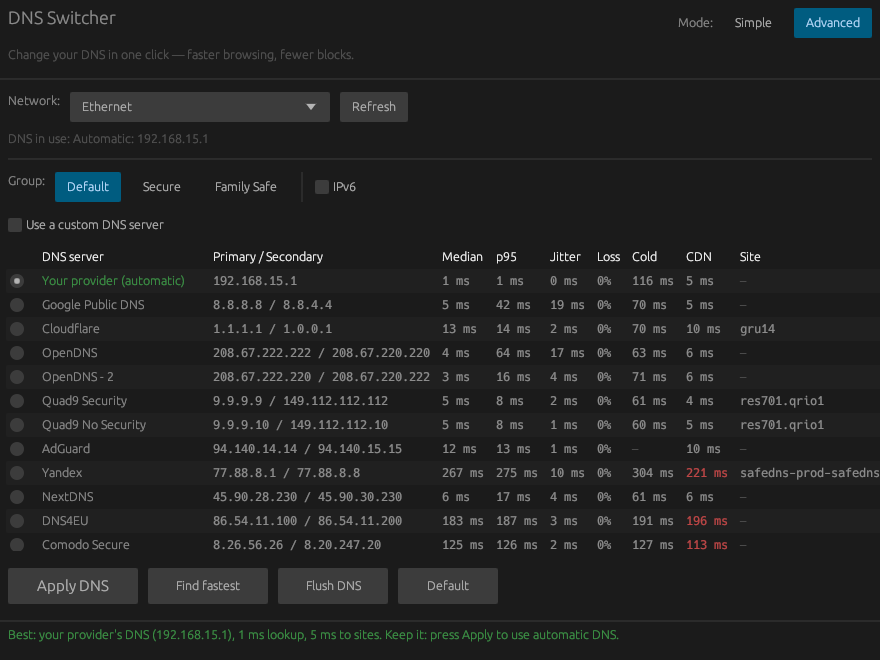

<p align="center">
  
</p>

<h1 align="center">DNS Switcher</h1>

<p align="center">
  Change your Windows DNS in one click and find out which resolver answers fastest from your network.
</p>

<p align="center">
  <a href="https://github.com/Devzinh/dns-switcher/releases">Download</a> &nbsp;&nbsp; <a href="#how-it-works">How it works</a> &nbsp;&nbsp; <a href="#roadmap">Roadmap</a>
</p>

<p align="center">
  <b>English</b> &nbsp;|&nbsp; <a href="README.pt-BR.md">Português</a>
</p>

<br>

A single executable for Windows 10 and 11. No installer, no telemetry, nothing left running in the background.

<p align="center">
  
</p>

Above is the exact packet the **Find fastest** button sends. The same packet goes to every resolver, and the first one to reply gets selected.

## What it does


**Simple mode.** Five well-known resolvers, each with one line saying what it's for. Pick one and click **Apply DNS**. The **Automatic** button gives you back your provider's DNS.

**Advanced mode.** 47 resolvers in three groups: general use, malware blocking and family filtering. It also has IPv6, a custom server and network adapter selection.

**Find fastest** measures every server on screen and selects the fastest. **Flush DNS** clears the Windows cache, so the change takes effect right away. The window also shows which DNS your adapter is using right now.

<br clear="right">



In advanced mode each server gets its own row of measurements:

| Column | Meaning |
|---|---|
| Median | Middle value of 5 lookups of a popular name, already in the resolver's cache |
| p95 | The slowest of those lookups. A big gap from the median means the server is inconsistent |
| Jitter | Average change between one lookup and the next |
| Loss | Lookups with no reply within 500 ms |
| Cold | One lookup of a random name the resolver has never seen, so it has to ask the authoritative servers. This is what you feel on sites you visit for the first time |
| Site | Which anycast location answered, when the resolver reports it (for example `gru14` is Cloudflare in São Paulo) |

## How it works

The app only uses tools that ship with Windows, plus a UDP socket.

| Step | What happens |
|---|---|
| List adapters | Reads `netsh interface ipv4 show interfaces` by column, so it works with Windows in any language. Skips loopback. |
| Measure | Builds DNS queries by hand (RFC 1035) and sends them over UDP to port 53: 5 lookups of `www.google.com` 80 ms apart, one lookup of a random name under `google.com`, and a CHAOS TXT `id.server` query. A reply only counts if it carries the same transaction id and the response flag. Each lookup has a 500 ms limit, and 6 servers are measured at a time. |
| Rank | Servers with at most 20% loss come first, ordered by median, then by p95. |
| Apply | `netsh interface ipv4 set dnsservers … static` for the primary server and `add dnsservers … index=2` for the secondary. For IPv6 it's the same command in the `ipv6` family. |
| Restore | Switches IPv4 and IPv6 back to DHCP. |
| Clear cache | `ipconfig /flushdns`. |

Everything that touches the network or the system runs off the UI thread, which gets the result back through a channel. The window never freezes. The app doesn't write files or registry keys either: Windows itself keeps the configuration.

```
src/
  main.rs       UI (egui), simple and advanced modes
  providers.rs  IPv4 and IPv6 resolver list, by group
  probe.rs      DNS queries over UDP, reply parsing and statistics
  sys.rs        netsh, ipconfig and adapters
```

## Installation

Download `dns_switcher.exe` from [Releases](https://github.com/Devzinh/dns-switcher/releases) and open it. Windows asks for administrator rights, because changing DNS requires them.

The executable isn't digitally signed yet. If SmartScreen warns you, click **More info** and then **Run anyway**. You can also build it yourself:

```powershell
git clone https://github.com/Devzinh/dns-switcher.git
cd dns-switcher
cargo build --release
.\target\release\dns_switcher.exe
```

Building requires stable Rust ([rustup.rs](https://rustup.rs)). Debug builds (`cargo run`) don't ask for administrator rights, so measuring works but applying DNS needs an elevated terminal.

Run the tests with `cargo test`. `cargo test -- --ignored --nocapture` also probes 1.1.1.1 over the network.

What changed in each version is in the [changelog](CHANGELOG.md).

## Included resolvers

| Group | Purpose | Examples |
|---|---|---|
| Default | General use | Cloudflare, Google, Quad9, Gcore, Control D, AdGuard, OpenDNS, NextDNS, CIRA Canadian Shield, DNS4EU, DNS.SB, AliDNS |
| Secure | Blocks malware and phishing | Cloudflare 1.1.1.2, Quad9 with ECS, Control D, CIRA Protected, CleanBrowsing Secure, DNS4EU Protective |
| Family Safe | Blocks adult content | Cloudflare 1.1.1.3, OpenDNS FamilyShield, Control D Family, CIRA Family, AdGuard Family |

The full list is in [`src/providers.rs`](src/providers.rs). Every address on it answered in a live test before release. Services change hands over time (Verisign and Neustar public DNS are now UltraDNS Public), and a server that stops replying shows 100% loss and is never picked.

To check the whole list from your own connection:

```powershell
cargo test --release --test live_resolvers -- --ignored --nocapture
```

## Roadmap

### AI-powered Fastest DNS

Today, **Find fastest** times a fixed list. The goal is for it to answer the question that matters: *will this DNS make my connection better, from here, right now?*

- [ ] You use your own API key (Claude, OpenAI and others). It's stored in Windows Credential Manager and never passes through any project server.
- [ ] Searches the web for this year's resolvers: new services, changed IPs, shut-down services and changes to data-logging policies. The built-in list becomes just a starting point.
- [ ] Locates your connection: public IP, carrier (ASN) and region.
- [x] Finds out which of the resolver's servers is actually answering. The same IP exists in many countries (anycast), and a `CHAOS TXT id.server` query reveals which one replied. *(0.1.1; NSID, RFC 5001, still to do)*
- [ ] Checks whether the resolver passes part of your IP on to CDNs (EDNS Client Subnet, RFC 7871). That decides which YouTube or Netflix server you get sent to.
- [x] Measures each server several times and computes median, p95, variation and loss. Also separates cached replies from full lookups, using a random domain. *(0.1.1)*
- [ ] Produces a score with an explanation: plain language for beginners, and the numbers for anyone who wants to check.
- [ ] Keeps working exactly as today for anyone who doesn't provide a key.

### Network and security

- [ ] Encrypted DNS (DoH and DoT), using Windows 11's native support
- [ ] Check whether the resolver validates DNSSEC
- [ ] Detect when the ISP intercepts queries or redirects nonexistent domains
- [ ] Detect DNS leaks while a VPN is on

### Everyday use

- [ ] Tray icon with quick switching
- [ ] Per-network profiles (home, work, public Wi-Fi)
- [x] Ask for administrator rights on launch *(0.1.1)*
- [ ] Sign the executable
- [ ] Interface in Portuguese, English and Spanish
- [ ] Command line for scripts: `dns_switcher --apply cloudflare --adapter "Wi-Fi"`

## FAQ

<details>
<summary>Does changing DNS increase download speed?</summary>
<br>
Not directly. DNS only translates names into addresses. The gain is in the time to the first connection with each site. Also, depending on the resolver, the CDN may send you to a closer server, and that affects streaming and gaming.
</details>

<details>
<summary>Why isn't the fastest one for me the fastest for someone else?</summary>
<br>
Public resolvers use anycast: the same IP exists in many places around the world. Which one serves you depends on the route your carrier picks, not on distance on a map. That's why the measurement has to run on your connection.
</details>

<details>
<summary>Does the app collect any data?</summary>
<br>
No. The only thing it sends over the network is the test queries to the resolvers you're measuring.
</details>

<details>
<summary>How do I undo it?</summary>
<br>
Click <b>Automatic</b> in simple mode or <b>Default</b> in advanced mode. That's equivalent to <code>netsh interface ipv4 set dnsservers name="Wi-Fi" dhcp</code>, plus the same command for IPv6.
</details>

## Contributing

To add or fix a resolver, edit `src/providers.rs` and include a link to the service's official page in the pull request. Run `cargo fmt` and `cargo clippy` before opening the PR.

When reporting a bug, include your Windows version and language, and paste the output of `netsh interface ipv4 show interfaces`.

## License

[MIT](LICENSE)
