<div align="center">


<br/>

[](https://www.rust-lang.org/)
[](https://github.com/emilk/egui)
[](#-instalação)
[](LICENSE)
[](#-contribuindo)

**Troque o DNS do Windows em um clique — do usuário leigo ao admin de rede.**
<br/>
Um binário nativo, sem instalador, sem telemetria, sem serviço rodando em segundo plano.

[Recursos](#-recursos) · [Como funciona](#-como-funciona) · [Instalação](#-instalação) · [Provedores](#-provedores-incluídos) · [Roadmap](#-roadmap) · [FAQ](#-faq-de-rede)

</div>

---

## ✨ Recursos

<table>
<tr>
<td width="50%" valign="top">

### 🟢 Modo Simples
Cinco resolvedores escolhidos a dedo, com uma frase explicando cada um.
Clique, **Apply DNS**, pronto. Botão **Automatic** volta para o DNS do seu provedor (DHCP).

### ⚡ Find fastest
Mede a latência real de cada resolvedor **a partir da sua rede** e já deixa o mais rápido selecionado.

### 🧹 Flush cache
Limpa o cache do resolvedor do Windows para a troca valer na hora.

</td>
<td width="50%" valign="top">

### 🛠️ Modo Avançado
- 3 grupos: **Default**, **Secure** (bloqueio de malware), **Family Safe** (filtro adulto)
- **IPv4 e IPv6**
- **DNS personalizado** (primário + secundário)
- Tabela com **latência por servidor** e destaque do vencedor
- Seleção do **adaptador de rede** (Ethernet, Wi-Fi, VPN…)

</td>
</tr>
</table>

<div align="center">

</div>

---

## 🔬 Como funciona


Nada de mágica, nada de driver. Só primitivas do próprio Windows e um socket UDP:

| Etapa | O que acontece | Implementação |
|---|---|---|
| **Descoberta** | Lista interfaces IPv4 (exceto loopback). Parse por colunas, independe do idioma do Windows. | `netsh interface ipv4 show interfaces` |
| **Medição** | Monta um *query* DNS tipo **A** na mão (header de 12 bytes, `RD=1`, `QDCOUNT=1`, classe `IN`) para `www.google.com` e envia via **UDP/53**. Mede o *round-trip* até a primeira resposta válida (≥ 12 bytes). | `std::net::UdpSocket`, timeout **500 ms** |
| **Seleção** | Menor RTT vence e é auto-selecionado. Servidor que não respondeu no prazo fica de fora. | — |
| **Aplicação** | Primário como `static`, secundário com `index=2`. Para IPv6, mesma coisa na família `ipv6`. | `netsh interface ipv4/ipv6 set/add dnsservers` |
| **Restauração** | Volta IPv4 **e** IPv6 para DHCP. | `netsh … set dnsservers … dhcp` |
| **Flush** | Invalida o cache do *DNS Client* para a mudança valer sem reiniciar. | `ipconfig /flushdns` |



> [!NOTE]
> **Leitura de engenheiro de rede:** a medição atual é **uma amostra por resolvedor**, então mede o RTT até o PoP *anycast* mais próximo **mais** o custo de cache do resolvedor naquele instante. É ótima para comparar vizinhos, mas não captura **jitter**, **perda** nem **p95**. Isso entra no [roadmap](#-roadmap).

### Arquitetura

```text
┌──────────────────────────── UI thread (egui / eframe) ───────────────────────────┐
│  Simple ▸ Advanced  ·  adapter picker  ·  server grid  ·  status bar (spinner)   │
└───────────────▲───────────────────────────────────────────────┬──────────────────┘
                │ mpsc::Receiver<Msg>                            │ thread::spawn
                │  Status(text, ok) · TestResult(i, ms) · Done   ▼
┌───────────────┴──────────────────── worker threads ────────────────────────────────┐
│  sys::apply_dns   sys::restore_dhcp   sys::flush_dns   sys::resolve_ms (UDP/53)    │
└──────────────────────────────┬─────────────────────────────────────────────────────┘
                               ▼
                 netsh · ipconfig  (CREATE_NO_WINDOW, sem console piscando)
```

- **UI nunca bloqueia**: toda operação de rede ou de sistema roda em *thread* separada e devolve o resultado por canal.
- **Sem estado persistente**: o app não grava arquivo, registro nem chave. Quem guarda a configuração é o próprio Windows.

```text
src/
├── main.rs        # UI (egui), estados, modos Simples/Avançado, mensagens
├── providers.rs   # Lista curada de resolvedores IPv4/IPv6 por grupo
└── sys.rs         # netsh/ipconfig, descoberta de adaptadores, sonda UDP DNS
```

---

## 📦 Instalação

### Compilar do código

Requer **Rust estável** ([rustup.rs](https://rustup.rs)) e Windows 10/11.

```powershell
git clone https://github.com/<seu-usuario>/dns-switcher.git
cd dns-switcher
cargo build --release
.\target\release\dns_switcher.exe
```

> [!IMPORTANT]
> **Trocar DNS exige privilégio de Administrador** (o `netsh` altera a configuração do adaptador).
> Abra o app com *botão direito → Executar como administrador*. Sem isso, a medição e o flush funcionam, mas **Apply** e **Automatic** retornam *Permission denied*.

---

## 🌍 Provedores incluídos

<details>
<summary><b>Default</b> — uso geral (21 IPv4 · 9 IPv6)</summary>

Google Public DNS · Cloudflare · OpenDNS · Quad9 (com e sem filtro) · AdGuard · Yandex · NextDNS · DNS4EU · Comodo Secure · Level 3 · Verisign · Norton ConnectSafe · Neustar · Hurricane Electric · SafeDNS · UltraDNS · Dyn
</details>

<details>
<summary><b>Secure</b> — bloqueio de malware/phishing</summary>

Cloudflare `1.1.1.2` · Yandex Safe · Comodo Secure · CleanBrowsing Secure · Neustar Threat Protection · DNS4EU Protective
</details>

<details>
<summary><b>Family Safe</b> — filtro de conteúdo adulto</summary>

Cloudflare `1.1.1.3` · OpenDNS FamilyShield · CleanBrowsing Family/Adult · Norton Family · Yandex Family · AdGuard Family · Neustar Family · DNS4EU Child
</details>

A lista vive em [`src/providers.rs`](src/providers.rs) — um PR adicionando/corrigindo resolvedor é a contribuição mais fácil possível.

> [!WARNING]
> Alguns serviços históricos da lista (ex.: Norton ConnectSafe, Verisign Public DNS, Dyn) foram **descontinuados** pelos operadores e podem não responder. O *Find fastest* simplesmente os ignora — e manter a lista viva automaticamente é exatamente o objetivo do item de IA no roadmap.

---

## 🗺️ Roadmap



### 🧠 Fastest DNS com IA (BYO API key)

A ideia: o botão **Fastest DNS** deixa de ser um cronômetro sobre uma lista fixa e vira um **analista de rede** que responde *"este DNS vai melhorar a MINHA conexão, daqui, agora?"*.

- [ ] **API key do próprio usuário** (Claude, OpenAI, etc.), guardada no **Windows Credential Manager** — nunca em texto plano, nunca enviada a servidor nosso.
- [ ] **Pesquisa web do ano corrente**: descobrir resolvedores novos, IPs alterados, serviços encerrados e políticas de privacidade/logging atualizadas. Lista local vira *cache*, não verdade absoluta.
- [ ] **Geolocalização e topologia**:
  - IP público, **ASN** e região do usuário;
  - **PoP anycast** que realmente responde (`CHAOS TXT id.server` / `hostname.bind`, NSID — RFC 5001);
  - checagem de **EDNS Client Subnet** (RFC 7871): o resolvedor manda seu /24 para a CDN? Isso muda para qual edge o YouTube/Netflix te envia.
- [ ] **Sonda multi-amostra**: N queries por servidor → **p50 / p95, jitter, perda**, separando *cache hit* de *cache miss* (domínio aleatório para forçar recursão).
- [ ] **Score explicado** pela IA: latência + estabilidade + proximidade do PoP + filtros + privacidade, com o **porquê** em linguagem simples para o leigo e os números crus para o avançado.
- [ ] Modo *offline-first*: sem API key, tudo continua funcionando como hoje.

### 🔐 Protocolos e segurança
- [ ] **DoH / DoT** (DNS over HTTPS/TLS) — configuração nativa do Windows 11 (`netsh dns add encryption`)
- [ ] Teste de **DNSSEC** (o resolvedor valida? `AD` flag em domínio assinado)
- [ ] Detecção de **sequestro de NXDOMAIN** e de **DNS transparente/interceptado** pelo ISP
- [ ] Checagem de **vazamento de DNS** com VPN ativa

### 🧰 Usabilidade
- [ ] Ícone na bandeja + troca rápida pelo menu
- [ ] Perfis por rede (casa / trabalho / Wi-Fi público)
- [ ] Manifesto UAC (pedir elevação automaticamente) e binário assinado nas *Releases*
- [ ] Tradução PT-BR / EN / ES na interface
- [ ] CLI headless (`--apply cloudflare --adapter "Wi-Fi"`) para scripts

---

## ❓ FAQ de rede

<details>
<summary><b>Trocar DNS aumenta minha velocidade de download?</b></summary>

Não diretamente. O DNS só traduz nomes em IPs. O que melhora é o **tempo até a primeira conexão** (cada site novo começa mais rápido) e, via anycast/ECS, **para qual servidor de CDN** você é mandado — e *isso* sim pode mudar a qualidade de streaming e jogos.
</details>

<details>
<summary><b>Por que o mais rápido aqui não é o mais rápido para meu amigo?</b></summary>

Resolvedores públicos são **anycast**: o mesmo IP é anunciado de dezenas de lugares e o BGP leva você ao "mais próximo" do ponto de vista do **seu ISP**, não do mapa. Por isso a medição é sempre local.
</details>

<details>
<summary><b>O app coleta algum dado?</b></summary>

Não. Nenhuma requisição além dos queries DNS de teste para os resolvedores que você está medindo. Sem telemetria, sem atualização automática, sem conta.
</details>

<details>
<summary><b>Como desfazer tudo?</b></summary>

Botão **Automatic** (Simples) ou **Default** (Avançado). Equivale a `netsh interface ipv4 set dnsservers name="<adaptador>" dhcp` e o mesmo para IPv6.
</details>

---

## 🤝 Contribuindo

1. *Fork* → branch → `cargo fmt && cargo clippy` → PR.
2. Resolvedor novo? Edite `src/providers.rs` e cite a página oficial do operador no PR.
3. Bugs: abra uma *issue* com versão do Windows, idioma do sistema e a saída de `netsh interface ipv4 show interfaces`.

## 📄 Licença

[MIT](LICENSE) — use, modifique e distribua à vontade.

<div align="center">
<sub>Feito com Rust 🦀 e egui.</sub>
</div>
