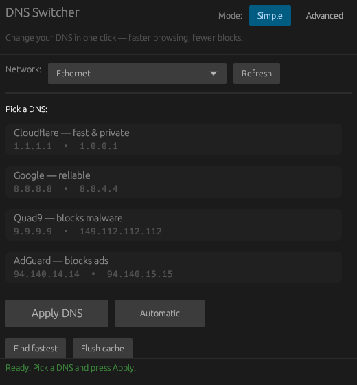

# DNS Switcher

Troque o DNS do Windows em um clique e descubra qual resolvedor responde mais rápido a partir da sua rede.

É um executável único para Windows 10 e 11. Não tem instalador, não envia telemetria e não deixa nada rodando em segundo plano.

<p align="center">
  
</p>

Acima está o pacote exato que o botão **Find fastest** envia. O mesmo pacote vai para cada resolvedor, e quem responder primeiro fica selecionado.

## O que faz



**Modo simples.** Cinco resolvedores conhecidos, cada um com uma linha dizendo para que serve. Escolha um e clique em **Apply DNS**. O botão **Automatic** devolve o DNS do seu provedor.

**Modo avançado.** Mais de 30 resolvedores em três grupos: uso geral, bloqueio de malware e filtro para família. Também tem IPv6, servidor personalizado, escolha do adaptador de rede e tempo de resposta de cada servidor.

**Find fastest** mede todos os servidores do grupo e seleciona o mais rápido. **Flush DNS** limpa o cache do Windows, então a troca vale na hora.

<br clear="right">

## Como funciona

O app só usa ferramentas que já vêm no Windows, mais um socket UDP.

| Etapa | O que acontece |
|---|---|
| Listar adaptadores | Lê `netsh interface ipv4 show interfaces` pelas colunas, então funciona com o Windows em qualquer idioma. Ignora o loopback. |
| Medir | Monta à mão uma consulta do tipo A para `www.google.com` (RFC 1035) e envia por UDP à porta 53. O tempo vai até chegar a primeira resposta válida. O limite é 500 ms. |
| Aplicar | `netsh interface ipv4 set dnsservers … static` para o servidor primário e `add dnsservers … index=2` para o secundário. Com IPv6 é o mesmo comando, na família `ipv6`. |
| Restaurar | Volta IPv4 e IPv6 para DHCP. |
| Limpar cache | `ipconfig /flushdns`. |

Tudo o que toca a rede ou o sistema roda fora da thread da interface, que recebe o resultado por um canal. A janela nunca trava. O app também não grava arquivo nem chave de registro: quem guarda a configuração é o próprio Windows.

A medição atual envia **uma consulta por servidor**. Ela serve para comparar resolvedores entre si, mas não mostra variação (jitter), perda de pacotes nem o pior caso. Isso está no roadmap.

```
src/
  main.rs       interface (egui), modos simples e avançado
  providers.rs  lista de resolvedores IPv4 e IPv6 por grupo
  sys.rs        netsh, ipconfig, adaptadores e a consulta UDP
```

## Instalação

Baixe `dns_switcher.exe` em [Releases](https://github.com/Devzinh/dns-switcher/releases), clique com o botão direito e escolha **Executar como administrador**.

Trocar o DNS exige permissão de administrador. Sem ela, medir e limpar o cache continuam funcionando, mas **Apply** e **Automatic** mostram *Permission denied*.

O executável ainda não tem assinatura digital. Se o SmartScreen avisar, clique em **Mais informações** e depois em **Executar assim mesmo**. Outra opção é compilar você mesmo:

```powershell
git clone https://github.com/Devzinh/dns-switcher.git
cd dns-switcher
cargo build --release
.\target\release\dns_switcher.exe
```

Para compilar é preciso ter o Rust estável ([rustup.rs](https://rustup.rs)).

## Resolvedores incluídos

| Grupo | Para quê | Exemplos |
|---|---|---|
| Default | Uso geral | Cloudflare, Google, Quad9, OpenDNS, AdGuard, NextDNS, DNS4EU |
| Secure | Bloqueia malware e phishing | Cloudflare 1.1.1.2, CleanBrowsing Secure, DNS4EU Protective |
| Family Safe | Bloqueia conteúdo adulto | Cloudflare 1.1.1.3, OpenDNS FamilyShield, AdGuard Family |

A lista completa está em [`src/providers.rs`](src/providers.rs). Alguns serviços antigos dessa lista, como Norton ConnectSafe, Verisign e Dyn, foram encerrados por quem os mantinha e não respondem mais. O teste de velocidade simplesmente os deixa de fora.

## Roadmap

### Fastest DNS com IA

Hoje, **Find fastest** cronometra uma lista fixa. A ideia é que ele passe a responder a pergunta que importa: *este DNS vai melhorar a minha conexão, daqui, agora?*

- [ ] Você usa a sua própria chave de API (Claude, OpenAI e outros). Ela fica guardada no Gerenciador de Credenciais do Windows e não passa por nenhum servidor do projeto.
- [ ] Pesquisa na web os resolvedores do ano atual: serviços novos, IPs que mudaram, serviços encerrados e mudanças na política de registro de dados. A lista embutida passa a ser só um ponto de partida.
- [ ] Localiza a sua conexão: IP público, operadora (ASN) e região.
- [ ] Descobre qual servidor do resolvedor está respondendo de fato. O mesmo IP existe em vários países (anycast), e uma consulta `CHAOS TXT id.server` ou NSID (RFC 5001) revela qual deles atendeu.
- [ ] Verifica se o resolvedor repassa parte do seu IP para as CDNs (EDNS Client Subnet, RFC 7871). Isso decide para qual servidor do YouTube ou da Netflix você é enviado.
- [ ] Mede várias vezes cada servidor e calcula mediana, p95, variação e perda. Também separa resposta em cache de consulta completa, usando um domínio aleatório.
- [ ] Gera uma nota com explicação: em linguagem simples para quem é leigo e com os números para quem quer conferir.
- [ ] Continua funcionando como hoje para quem não informar uma chave.

### Rede e segurança

- [ ] DNS criptografado (DoH e DoT), usando o suporte nativo do Windows 11
- [ ] Verificar se o resolvedor valida DNSSEC
- [ ] Detectar quando o provedor intercepta consultas ou redireciona domínios inexistentes
- [ ] Detectar vazamento de DNS com VPN ligada

### Uso diário

- [ ] Ícone na bandeja com troca rápida
- [ ] Perfis por rede (casa, trabalho, Wi-Fi público)
- [ ] Pedir permissão de administrador ao abrir e assinar o executável
- [ ] Interface em português, inglês e espanhol
- [ ] Linha de comando para scripts: `dns_switcher --apply cloudflare --adapter "Wi-Fi"`

## Perguntas frequentes

<details>
<summary>Trocar o DNS aumenta a velocidade de download?</summary>
<br>
Não diretamente. O DNS só traduz nomes em endereços. O ganho está no tempo até a primeira conexão com cada site. Além disso, dependendo do resolvedor, a CDN pode te mandar para um servidor mais próximo, e isso afeta streaming e jogos.
</details>

<details>
<summary>Por que o mais rápido para mim não é o mais rápido para outra pessoa?</summary>
<br>
Resolvedores públicos usam anycast: o mesmo IP existe em vários lugares do mundo. Qual deles te atende depende do caminho que a sua operadora escolhe, não da distância no mapa. Por isso a medição precisa ser feita na sua conexão.
</details>

<details>
<summary>O app coleta algum dado?</summary>
<br>
Não. A única coisa que ele envia pela rede são as consultas de teste aos resolvedores que você está medindo.
</details>

<details>
<summary>Como desfazer?</summary>
<br>
Clique em <b>Automatic</b> no modo simples ou em <b>Default</b> no avançado. Isso equivale a <code>netsh interface ipv4 set dnsservers name="Wi-Fi" dhcp</code>, mais o mesmo comando para IPv6.
</details>

## Contribuir

Para adicionar ou corrigir um resolvedor, edite `src/providers.rs` e coloque no pull request o link para a página oficial do serviço. Antes de abrir o PR, rode `cargo fmt` e `cargo clippy`.

Ao relatar um bug, informe a versão e o idioma do Windows e cole a saída de `netsh interface ipv4 show interfaces`.

## Licença

[MIT](LICENSE)
