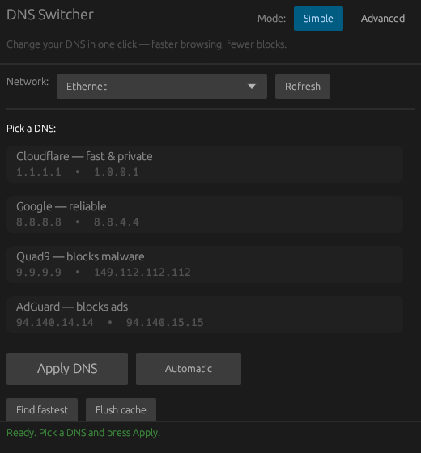
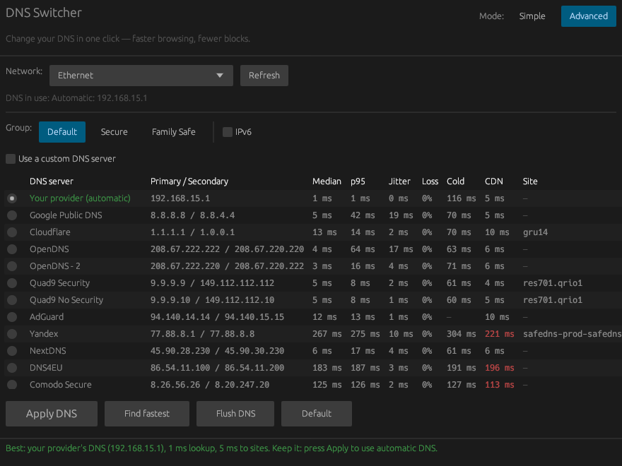

<p align="center">
  
</p>

<h1 align="center">DNS Switcher</h1>

<p align="center">
  Troque o DNS do Windows em um clique e descubra qual resolvedor responde mais rápido a partir da sua rede.
</p>

<p align="center">
  <a href="https://github.com/Devzinh/dns-switcher/releases">Baixar</a> &nbsp;&nbsp; <a href="#como-funciona">Como funciona</a> &nbsp;&nbsp; <a href="#roadmap">Roadmap</a>
</p>

<p align="center">
  <a href="README.md">English</a> &nbsp;|&nbsp; <b>Português</b>
</p>

<br>

É um executável único para Windows 10 e 11. Não tem instalador, não envia telemetria e não deixa nada rodando em segundo plano.

<p align="center">
  
</p>

Acima está o pacote exato que o botão **Find fastest** envia. O mesmo pacote vai para cada resolvedor, e quem responder primeiro fica selecionado.

## O que faz



**Modo simples.** Cinco resolvedores conhecidos, cada um com uma linha dizendo para que serve. Escolha um e clique em **Apply DNS**. O botão **Automatic** devolve o DNS do seu provedor.

**Modo avançado.** 47 resolvedores em três grupos: uso geral, bloqueio de malware e filtro para família. Também tem IPv6, servidor personalizado e escolha do adaptador de rede.

**Find fastest** mede todos os servidores da tela e seleciona o mais rápido. **Flush DNS** limpa o cache do Windows, então a troca vale na hora. A janela também mostra qual DNS o adaptador está usando agora.

<br clear="right">



No modo avançado cada servidor ganha uma linha de medições:

| Coluna | Significado |
|---|---|
| Median | Valor do meio de 5 consultas a um nome popular, que já está no cache do resolvedor |
| p95 | A mais lenta dessas consultas. Se ficar muito acima da mediana, o servidor é instável |
| Jitter | Quanto o tempo varia, em média, de uma consulta para a seguinte |
| Loss | Consultas sem resposta em até 500 ms |
| Cold | Uma consulta a um nome aleatório que o resolvedor nunca viu, então ele precisa perguntar aos servidores autoritativos. É o que você sente ao abrir um site pela primeira vez |
| Site | Qual unidade anycast respondeu, quando o resolvedor informa (por exemplo, `gru14` é a Cloudflare em São Paulo) |

## Como funciona

O app só usa ferramentas que já vêm no Windows, mais um socket UDP.

| Etapa | O que acontece |
|---|---|
| Listar adaptadores | Lê `netsh interface ipv4 show interfaces` pelas colunas, então funciona com o Windows em qualquer idioma. Ignora o loopback. |
| Medir | Monta consultas DNS à mão (RFC 1035) e envia por UDP à porta 53: 5 consultas a `www.google.com` com 80 ms de intervalo, uma consulta a um nome aleatório dentro de `google.com` e uma consulta CHAOS TXT `id.server`. Uma resposta só vale se trouxer o mesmo id de transação e a marca de resposta. Cada consulta tem limite de 500 ms, e 6 servidores são medidos ao mesmo tempo. |
| Classificar | Servidores com até 20% de perda vêm primeiro, ordenados pela mediana e depois pelo p95. |
| Aplicar | `netsh interface ipv4 set dnsservers … static` para o servidor primário e `add dnsservers … index=2` para o secundário. Com IPv6 é o mesmo comando, na família `ipv6`. |
| Restaurar | Volta IPv4 e IPv6 para DHCP. |
| Limpar cache | `ipconfig /flushdns`. |

Tudo o que toca a rede ou o sistema roda fora da thread da interface, que recebe o resultado por um canal. A janela nunca trava.

### App e serviço

```
 App DNS Switcher (seu usuário, sem admin)        DNS Switcher Service (LocalSystem)
 janela, ícone na bandeja, medições     ──────►  valida o pedido e executa
                                     pipe local   netsh / ipconfig do System32
```

Medir não exige permissão especial, então o próprio app faz isso. Aplicar o DNS, voltar ao DHCP e limpar o cache vão para o serviço pelo pipe local `\\.\pipe\DnsSwitcherService`:

- O pipe aceita SYSTEM e Administradores, além de usuários conectados neste computador. Conexões pela rede são recusadas.
- Cada pedido é uma linha, com um conjunto fixo de comandos. Os endereços precisam ser IPs válidos da família pedida. O adaptador precisa existir, e o próprio serviço descobre o índice da interface.
- Os comandos são iniciados do `System32` pelo caminho completo, nunca por um shell, e só recebem endereços validados e um número como argumentos.
- O caminho do serviço fica entre aspas na configuração do serviço.

O app grava um único valor no registro, e só se você ligar **Start with Windows**: `DNS Switcher` em `HKCU\Software\Microsoft\Windows\CurrentVersion\Run`. A configuração de DNS em si fica com o Windows.

```
src/
  main.rs       interface (egui), modos simples e avançado
  tray.rs       ícone na área de notificação, menu e Start with Windows
  service.rs    o serviço do Windows e seu pipe, e o lado cliente do app
  ipc.rs        formato e validação dos pedidos
  sys.rs        netsh, ipconfig e adaptadores
  probe.rs      consultas DNS por UDP, leitura das respostas e estatísticas
  providers.rs  lista de resolvedores IPv4 e IPv6 por grupo
installer/
  dns-switcher.iss   script do Inno Setup
```

## Instalação

Baixe **`DNS-Switcher-Setup-<versão>.exe`** em [Releases](https://github.com/Devzinh/dns-switcher/releases) e execute. O instalador pede permissão de administrador uma vez e instala:

- o app em `Arquivos de Programas\DNS Switcher`, com atalho no Menu Iniciar e desinstalação em **Configurações → Aplicativos**;
- o **DNS Switcher Service**, que aparece no `services.msc`. Ele é a única parte que altera configurações de rede, então o app abre sem prompt do UAC;
- opcionalmente, uma entrada que inicia o DNS Switcher na área de notificação quando você entra no Windows.

Fechar a janela mantém o DNS Switcher na área de notificação. Clique no ícone para abrir, ou clique com o botão direito para trocar rápido, usar **Automatic**, **Find fastest** e **Start with Windows**. **Quit** nesse menu encerra o app.

Desinstalar por **Configurações → Aplicativos** para e remove o serviço e a entrada de inicialização. O DNS atual não é alterado; clique em **Automatic** antes se quiser voltar ao DNS do seu provedor.

O executável e o instalador ainda não têm assinatura digital, então o SmartScreen pode avisar: clique em **Mais informações** e depois em **Executar assim mesmo**. A [política de assinatura de código](CODE_SIGNING.md) (code signing policy) explica como as versões são compiladas e serão assinadas. Cada release traz os hashes SHA-256, e o `dns_switcher.exe` traz informações de versão que você confere em **Propriedades → Detalhes**.

### Sem instalar

O `dns_switcher.exe` também roda sozinho. Sem o serviço ele consegue medir os resolvedores, mas para aplicar o DNS precisa ser aberto com **Executar como administrador**.

### Compilando

```powershell
git clone https://github.com/Devzinh/dns-switcher.git
cd dns-switcher
cargo build --release
& "${env:ProgramFiles(x86)}\Inno Setup 6\ISCC.exe" installer\dns-switcher.iss
```

Isso gera `target\release\dns_switcher.exe` e `installer\Output\DNS-Switcher-Setup-<versão>.exe`. É preciso ter o Rust estável ([rustup.rs](https://rustup.rs)) e, para o instalador, o [Inno Setup 6](https://jrsoftware.org/isinfo.php).

Os testes rodam com `cargo test`. `cargo test -- --ignored --nocapture` também mede o 1.1.1.1 pela rede.

O que mudou em cada versão está no [changelog](CHANGELOG.md).

## Resolvedores incluídos

| Grupo | Para quê | Exemplos |
|---|---|---|
| Default | Uso geral | Cloudflare, Google, Quad9, Gcore, Control D, AdGuard, OpenDNS, NextDNS, CIRA Canadian Shield, DNS4EU, DNS.SB, AliDNS |
| Secure | Bloqueia malware e phishing | Cloudflare 1.1.1.2, Quad9 com ECS, Control D, CIRA Protected, CleanBrowsing Secure, DNS4EU Protective |
| Family Safe | Bloqueia conteúdo adulto | Cloudflare 1.1.1.3, OpenDNS FamilyShield, Control D Family, CIRA Family, AdGuard Family |

A lista completa está em [`src/providers.rs`](src/providers.rs). Todos os endereços dela responderam em um teste ao vivo antes da publicação. Os serviços mudam de dono com o tempo (os DNS públicos da Verisign e da Neustar hoje são o UltraDNS Public), e um servidor que para de responder aparece com 100% de perda e nunca é escolhido.

Para conferir a lista inteira a partir da sua conexão:

```powershell
cargo test --release --test live_resolvers -- --ignored --nocapture
```

## Roadmap

### Fastest DNS com IA

Hoje, **Find fastest** cronometra uma lista fixa. A ideia é que ele passe a responder a pergunta que importa: *este DNS vai melhorar a minha conexão, daqui, agora?*

- [ ] Você usa a sua própria chave de API (Claude, OpenAI e outros). Ela fica guardada no Gerenciador de Credenciais do Windows e não passa por nenhum servidor do projeto.
- [ ] Pesquisa na web os resolvedores do ano atual: serviços novos, IPs que mudaram, serviços encerrados e mudanças na política de registro de dados. A lista embutida passa a ser só um ponto de partida.
- [ ] Localiza a sua conexão: IP público, operadora (ASN) e região.
- [x] Descobre qual servidor do resolvedor está respondendo de fato. O mesmo IP existe em vários países (anycast), e uma consulta `CHAOS TXT id.server` revela qual deles atendeu. *(0.1.1; falta o NSID, RFC 5001)*
- [ ] Verifica se o resolvedor repassa parte do seu IP para as CDNs (EDNS Client Subnet, RFC 7871). Isso decide para qual servidor do YouTube ou da Netflix você é enviado.
- [x] Mede várias vezes cada servidor e calcula mediana, p95, variação e perda. Também separa resposta em cache de consulta completa, usando um domínio aleatório. *(0.1.1)*
- [ ] Gera uma nota com explicação: em linguagem simples para quem é leigo e com os números para quem quer conferir.
- [ ] Continua funcionando como hoje para quem não informar uma chave.

### Rede e segurança

- [ ] DNS criptografado (DoH e DoT), usando o suporte nativo do Windows 11
- [ ] Verificar se o resolvedor valida DNSSEC
- [ ] Detectar quando o provedor intercepta consultas ou redireciona domínios inexistentes
- [ ] Detectar vazamento de DNS com VPN ligada

### Uso diário

- [x] Ícone na bandeja com troca rápida *(0.1.1)*
- [ ] Perfis por rede (casa, trabalho, Wi-Fi público)
- [x] Instalador e serviço do Windows, para o app rodar sem permissão de administrador *(0.1.1)*
- [ ] Assinar o executável e o instalador (por exemplo pela [SignPath Foundation](https://signpath.org), que assina projetos open source de graça)
- [ ] Publicar no winget (`winget install DnsSwitcher`)
- [ ] Interface em português, inglês e espanhol
- [ ] Linha de comando para scripts: `dns_switcher --apply cloudflare --adapter "Wi-Fi"`

## Perguntas frequentes

<details>
<summary>Trocar o DNS aumenta a velocidade de download?</summary>
<br>
Não diretamente. O DNS só traduz nomes em endereços. O ganho está no tempo até a primeira conexão com cada site. Além disso, dependendo do resolvedor, a CDN pode te mandar para um servidor mais próximo, e isso afeta streaming e jogos.
</details>

<details>
<summary>Por que o mais rápido para mim não é o mais rápido para outra pessoa?</summary>
<br>
Resolvedores públicos usam anycast: o mesmo IP existe em vários lugares do mundo. Qual deles te atende depende do caminho que a sua operadora escolhe, não da distância no mapa. Por isso a medição precisa ser feita na sua conexão.
</details>

<details>
<summary>O app coleta algum dado?</summary>
<br>
Não. A única coisa que ele envia pela rede são as consultas de teste aos resolvedores que você está medindo.
</details>

<details>
<summary>Como desfazer?</summary>
<br>
Clique em <b>Automatic</b> no modo simples ou em <b>Default</b> no avançado. Isso equivale a <code>netsh interface ipv4 set dnsservers name="Wi-Fi" dhcp</code>, mais o mesmo comando para IPv6.
</details>

## Contribuir

Para adicionar ou corrigir um resolvedor, edite `src/providers.rs` e coloque no pull request o link para a página oficial do serviço. Antes de abrir o PR, rode `cargo fmt` e `cargo clippy`.

Ao relatar um bug, informe a versão e o idioma do Windows e cole a saída de `netsh interface ipv4 show interfaces`.

## Code signing policy

Free code signing provided by [SignPath.io](https://about.signpath.io), certificate by [SignPath Foundation](https://signpath.org), assim que o pedido do projeto for aprovado. As versões são compiladas pelo GitHub Actions a partir deste repositório. Papéis da equipe, a declaração de privacidade e o que o instalador altera estão em [CODE_SIGNING.md](CODE_SIGNING.md).

## Licença

[MIT](LICENSE)
